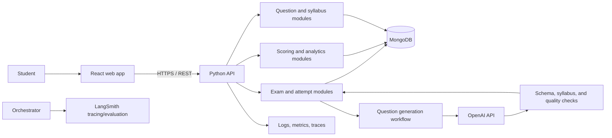

# NEET Sample Question Practice Application

## 1. Purpose and scope

Build a private, reliable web application where a student selects syllabus topics and can add optional instructions (such as desired difficulty or topic emphasis) to generate a 180-question NEET-style practice paper with an LLM. She can take it under timed conditions, submit it, and review a scored result with explanations and study recommendations. Keep a durable history of generated papers, answers, scores, and topic-level trends. This is a private single-student application; accounts, login, and multi-user access management are out of scope.

This is a practice and learning tool. Generated questions should be described as original NEET-style practice, not official NEET questions or predictions. Treat the exam blueprint and syllabus as versioned data: the requested 180-question paper is the initial product requirement, while subject counts, marking rules, duration, and syllabus coverage should be configurable and checked against the applicable official exam materials before use.

## 2. Proposed architecture

Start with a **modular Python backend** exposed as a REST API, a React single-page application, and MongoDB. Keep module boundaries clear so individual backend modules can be extracted into services later if scale or independent deployment needs justify that complexity. For a private single-student deployment, distributed microservices and identity management would add operational overhead without an immediate benefit.



### Core design choices

- **Generate from the selected syllabus:** Each paper request includes selected syllabus topics, the 180-question blueprint, and optional student instructions. The backend sends this context to the LLM, generates the questions (in manageable batches if needed), validates the complete paper, and only then makes it available. Model calls happen before the timed exam starts.
- **Deterministic scoring:** Compute marks from stored answers and the generated paper's answer-key and marking-scheme snapshots. The LLM must not decide scores or grade student responses.
- **Structured model output:** Ask the model for a strict question schema, then validate it in application code. Treat model output as untrusted input. Reject malformed questions and do not silently publish them.
- **Versioned content:** Store syllabus version, exam blueprint, prompt/model version, question revision, and marking-scheme revision so old attempts remain reproducible when content changes.
- **Modular monolith first:** Keep API, generation workflow, scoring, and analytics as separately testable modules. Introduce queues/workers and separate services only when workload or operational needs call for them.

## 3. Components and responsibilities

| Component | Responsibilities |
| --- | --- |
| React student application | Syllabus/chapter selection, optional generation-instructions form, exam instructions, timer, question navigation, answer selection, autosave state, submission, results, and history/analytics views. No sign-in flow is needed. |
| Python API | Request validation, business rules, API versioning, basic operational safeguards, and coordination between modules. FastAPI is a suitable starting framework. |
| Syllabus and blueprint module | Manage syllabus editions, subjects, chapters, topics, coverage rules, paper size, subject distribution, duration, and marking scheme as editable/versioned data. |
| Question history module | Persist each generated paper with questions, options, correct answers, explanations, topic tags, generation metadata, and validation results. Past questions may be reused when requested; generation is driven by the current syllabus and instructions. |
| Generation workflow | Accept selected syllabus topics and optional free-text instructions, construct a constrained prompt and blueprint, call OpenAI with structured output, record model/prompt metadata, generate in batches if useful, validate the assembled paper, and return it only when complete. LangChain can orchestrate the workflow; keep core rules in ordinary Python functions. |
| Validation | Check schema, exactly one unambiguous correct option, plausible distractors, syllabus alignment, duplicates/similarity, explanation consistency, and blueprint coverage. Automated checks reduce errors but do not establish scientific correctness; optionally allow parent review before starting. |
| Exam/attempt module | Persist the generated paper and scoring settings, manage start/deadline/status, save answers, support resume, and enforce one final submission. Use server time as authoritative. |
| Scoring module | Score objective responses deterministically using the attempt's snapshot of the answer key and marking scheme. Persist per-question outcome and aggregate subject/topic scores. |
| Results and recommendation module | Explain correct answers, summarize strengths and gaps, identify topics for revision, and propose follow-up practice based on attempt history. Use transparent rules first; if an LLM summarizes results, provide only the required data and clearly separate suggestions from official scoring. |
| History and analytics module | List attempts and results; calculate accuracy, time spent, unanswered questions, subject/topic trends, and progress over time. Preserve historical snapshots so edits to the bank do not alter prior results. |
| MongoDB | Persist syllabus/blueprint versions, generation requests, generated papers, attempts, answers, results, and generation/validation metadata. Add indexes for attempt date/status and syllabus/topic. |
| Background worker (later or as needed) | Run slow generation, deduplication, reports, and retryable jobs outside web requests. Use a durable queue when asynchronous workloads justify it. |
| Observability | Application logs, error reporting, request/job metrics, and traces. LangSmith can trace/evaluate LLM workflows; it does not replace general production monitoring. Redact student identifiers and answers from traces where possible. |

### Suggested student flow

1. Select syllabus edition and subjects/chapters; optionally provide instructions such as difficulty, emphasis, or question style.
2. Backend asks the LLM to generate the 180-question paper from that syllabus and instruction set, validates it, and stores an immutable paper, answer-key, and scoring snapshot.
3. Student starts the attempt. The client shows the timer and saves answers periodically and on navigation; the server stores the authoritative state.
4. Student submits, or the server closes the attempt when time expires. Submission is idempotent so retries cannot create duplicate results.
5. Backend scores the snapshot deterministically and records subject/topic breakdowns.
6. UI displays the score, per-question answer and explanation, topic analysis, and recommended next practice. The attempt remains available in history.

## 4. Data model outline

Use MongoDB documents with stable IDs and explicit version fields. Avoid embedding unbounded attempt history inside a single document.

- **SyllabusVersion:** name/year, source/review metadata, subjects, chapter/topic tree, active status.
- **GenerationRequest:** selected syllabus version and topic IDs, optional instructions, requested question count/settings, prompt/model versions, status, and timestamps.
- **ExamBlueprint:** syllabus version, total question count (180 initially), per-subject/topic constraints, duration, marking rules, version.
- **Question:** stem, options, correct option, explanation, subject/chapter/topic IDs, difficulty, language, validation result, content version, generation metadata, timestamps.
- **ExamPaper:** generation request ID, selected scope, optional instructions, blueprint version, ordered immutable question snapshots, answer-key snapshot, marking rules, created time.
- **Attempt:** paper ID/snapshot, status, start/deadline/submission times, answer map, autosave/version metadata.
- **Result:** attempt ID, scoring version, total and subject/topic aggregates, per-question correctness/marks/time if collected, recommendation data, finalized time.
- **GenerationRun/AuditEvent:** request scope, prompt/model versions, validation outcomes, reviewer decisions, timestamps, and operational status. Store no unnecessary personal data.

For autosave, use an upsert keyed by attempt and question (or a bounded answer map with revision numbers), and reject writes after final submission. Add a unique constraint or equivalent idempotency key for finalization.

## 5. Dependencies

Choose and pin compatible versions during implementation; the list below names likely packages, not version commitments.

### Frontend

- React and TypeScript; Vite for the development/build toolchain.
- React Router for page navigation.
- TanStack Query for API state and cache; a small local state store only if needed for the active exam.
- React Hook Form and Zod for forms and client-side schema checks.
- A component library such as MUI or shadcn/ui, selected once to keep the interface consistent.
- Vitest and React Testing Library for UI tests; Playwright for end-to-end exam flow tests.

### Backend

- Python 3.x, FastAPI, Pydantic, and Uvicorn.
- PyMongo (or the MongoDB-supported async driver available at implementation time) for MongoDB access; define repository boundaries so the driver can change without leaking into business logic.
- OpenAI Python SDK for model API calls; use structured outputs/function schemas supported by the chosen model.
- LangChain components only for orchestration/retrieval patterns that are useful; keep scoring, eligibility, and validation logic deterministic and directly testable.
- Optional: Redis plus a task queue such as Celery, Dramatiq, or RQ for asynchronous generation when needed. Do not add a queue until there is a real background workload.
- Pytest, HTTPX test client, Ruff, and mypy (or Pyright) for quality checks.

### Data, deployment, and operations

- MongoDB Community/Atlas, with automated backups and a documented restore process.
- Docker and Docker Compose for reproducible local development; a managed container platform for deployment when selected.
- Secret manager/environment injection for OpenAI and database credentials; never commit secrets.
- Structured logging and error reporting (for example, OpenTelemetry-compatible instrumentation plus a hosted or self-managed backend).
- LangSmith for LLM trace inspection and dataset-based prompt/workflow evaluation, configured with privacy-aware redaction and retention.
- CI pipeline for linting, type checks, tests, dependency/security scanning, and build artifacts.

## 6. Suggested folder structure

```text
neet-practice/
├── README.md
├── NEET-Generate-Sample-Questions.md
├── .env.example
├── docker-compose.yml
├── frontend/
│   ├── package.json
│   ├── src/
│   │   ├── app/                 # Router, app shell, providers
│   │   ├── features/
│   │   │   ├── syllabus/
│   │   │   ├── exam/
│   │   │   ├── results/
│   │   │   └── history/
│   │   ├── components/          # Shared UI components
│   │   ├── services/            # Typed API client
│   │   └── types/
│   └── tests/
├── backend/
│   ├── pyproject.toml
│   ├── app/
│   │   ├── main.py              # FastAPI application entry point
│   │   ├── api/v1/              # HTTP routes and request/response models
│   │   ├── core/                # Settings, errors, logging
│   │   ├── modules/
│   │   │   ├── users/
│   │   │   ├── syllabus/
│   │   │   ├── questions/
│   │   │   ├── generation/
│   │   │   ├── exams/
│   │   │   ├── scoring/
│   │   │   ├── analytics/
│   │   │   └── recommendations/
│   │   ├── db/                  # Mongo client, indexes, repositories
│   │   ├── workers/             # Optional background jobs
│   │   └── observability/
│   └── tests/
├── content/
│   ├── syllabus/                # Reviewed, versioned syllabus imports
│   ├── blueprints/
│   └── prompt-templates/
├── infra/
│   ├── docker/
│   └── deployment/              # Add environment-specific deployment files
└── docs/
    ├── api.md
    ├── data-model.md
    └── operations.md
```

The existing repository contains a `python-agent-poc/` directory. This proposed layout is a target structure; implementation can either evolve that prototype or create the `frontend/` and production backend modules alongside it, after reviewing its current contents.

## 7. Implementation steps

1. **Confirm paper rules:** Identify syllabus edition, duration, subject distribution, marking rules, language, and optional generation settings such as difficulty mix and topic emphasis. Record these in versioned configuration. No account or login flow is required.
2. **Define syllabus and blueprint:** Import the chosen official syllabus into a reviewable topic tree. Define the initial 180-question blueprint and mark its source/version/date.
3. **Define schemas and API contracts:** Specify generation request, question, paper, attempt, answer, result, and history structures; document endpoints before building UI and backend modules.
4. **Build the application foundation:** Set up React/TypeScript, FastAPI, MongoDB connectivity, configuration, structured logging, and local Docker development.
5. **Implement syllabus-driven generation:** Add syllabus selection and optional-instructions UI, OpenAI structured generation, prompt/version tracking, batch handling, schema/content checks, duplicate detection, and failure recovery. Validate the complete generated paper before exposing it as an exam.
6. **Implement exam-taking:** Persist each generated paper snapshot; add timer, navigation, autosave, resume, and reliable submission/expiry behavior.
8. **Implement scoring and result history:** Compute results from the stored key and marking snapshot; add explanations, subject/topic aggregates, attempt history, and basic trend views.
9. **Add recommendations:** Start with understandable rules based on topic accuracy and unanswered questions. Introduce an LLM-generated narrative only as a constrained optional layer, checked against computed facts.
10. **Harden and deploy:** Verify backups/restores, safe API exposure for the private deployment, data retention, privacy-conscious telemetry, error handling, accessibility, and mobile layouts. Run end-to-end flows from generation through historical result review.
11. **Iterate from usage:** Review question quality and student feedback, refine blueprint coverage, and add spaced practice, adaptive difficulty, or a background worker only when they solve an observed need.

## 8. Key quality and privacy safeguards

- Never let generated content enter a live exam until it passes validation and the chosen review policy.
- Show the syllabus edition and practice-paper settings for each exam; retain them with the attempt.
- Do not ask an LLM to score or infer correctness. Recompute scores from answer keys and explicit rules.
- Make submission safe to retry and autosave resilient to refreshes or brief network loss.
- Keep API keys server-side and avoid exposing the service publicly without adding appropriate access controls.
- Collect only data needed for learning history. Avoid sending student names, account identifiers, or full answer history to LLMs unless necessary; redact traces and control retention.
- Provide accessible controls, readable explanations, keyboard navigation, and responsive layouts.
- Keep generation metadata and validation outcomes with each paper; historical results must remain tied to the exact question and scoring versions taken.
